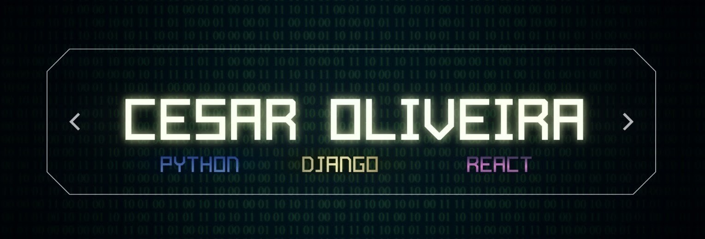

<!-- BANNER PRINCIPAL -->

  

<!-- BOTÕES DE CONTATO (FOR-THE-BADGE COM CORES SUTIS/DARK) -->

  
  &nbsp;
  
  &nbsp;
  

 

<!-- APRESENTAÇÃO E EFEITO TYPING COM CONTROLES VISUAIS MELHORADOS -->

  <h1>👋 Olá, eu sou o César Oliveira</h1>

  

    

  

    Desenvolvo aplicações web full stack focadas no ecossistema <b>Python (Django/DRF) e React</b>. 
    Tenho direcionamento prático para construção de APIs RESTful, sistemas assíncronos, segurança de aplicações (OWASP) e automação de testes.
  

  

    📍 <b>São Benedito, Ceará, Brasil</b> &nbsp;•&nbsp; 🎓 <b>Graduando em Ciência da Computação no IFCE</b> &nbsp;•&nbsp; 💼 <b>Buscando primeira oportunidade como Desenvolvedor Júnior (Remoto)</b>
  

 

---

 

<!-- STACK PRINCIPAL CENTRALIZADA COM GRID EQUILIBRADO -->
<h2 align="center">🛠️ Stack Principal</h2>

 

  
  &nbsp;&nbsp;&nbsp;&nbsp;&nbsp;&nbsp;&nbsp;&nbsp;
  
  &nbsp;&nbsp;&nbsp;&nbsp;&nbsp;&nbsp;&nbsp;&nbsp;
  
  &nbsp;&nbsp;&nbsp;&nbsp;&nbsp;&nbsp;&nbsp;&nbsp;
  
  &nbsp;&nbsp;&nbsp;&nbsp;&nbsp;&nbsp;&nbsp;&nbsp;
  
  &nbsp;&nbsp;&nbsp;&nbsp;&nbsp;&nbsp;&nbsp;&nbsp;
  
  &nbsp;&nbsp;&nbsp;&nbsp;&nbsp;&nbsp;&nbsp;&nbsp;
  

 

### ⚙️ Como atuo no desenvolvimento

| Área | Escopo de Atuação |
| :--- | :--- |
| **Back-end** | APIs RESTful com Django REST Framework e Flask, tarefas em background com Celery/Redis e rotas assíncronas. |
| **Front-end** | Aplicações reativas com React.js, consumo de APIs REST e estilização responsiva com Tailwind CSS. |
| **Banco de Dados & DevOps** | Modelagem relacional em PostgreSQL, containerização de ambientes com Docker e deploy na nuvem. |
| **Qualidade & Segurança** | Cobertura de testes automatizados (pytest/Vitest), autenticação JWT/OAuth 2.0 e mitigação de falhas OWASP. |

 

---

 

## 🚀 Projetos Autorais em Destaque

> ### 💳 [FinFlow — SaaS Financeiro Multi-Tenant](https://github.com/devCesar26-maker/GESTOR_FINANCAS)
> Plataforma de gestão financeira com 23 rotas REST (OpenAPI 3), filas assíncronas via Celery/Redis e 283 testes automatizados (92% de cobertura backend). Proteções OWASP contra SQLi, XSS e CSRF.  
> 🔗 **[Acessar Demo Online](https://gestor-financeiro-h91s.onrender.com)**

 

> ### 📄 [ResumeForge — Automação com IA](https://github.com/devCesar26-maker/ResumeForge)
> Geração e adaptação inteligente de documentos integrando LLMs (Gemini e Groq), web scraping de vagas e visualizações métricas com Plotly.js.  
> 🔗 **[Acessar Demo Online](https://resumeforge-jg6l.onrender.com)**

 

> ### 📚 [Sistema de Gestão de Biblioteca](https://github.com/devCesar26-maker/Biblioteca)
> Aplicação em Django e PostgreSQL com autenticação OAuth 2.0 (Google), motor de busca full-text e controle de acesso a arquivos.  
> 🔗 **[Acessar Demo Online](https://biblioteca-c1ca.onrender.com)**

 

---

 

## 🏆 Raciocínio Lógico & Resolução de Problemas

* **Histórico Olímpico (OBMEP, OBA e preparação OBI):** Premiações em olimpíadas científicas que consolidaram minha base teórica em lógica matemática, algoritmos e estruturas de dados.
